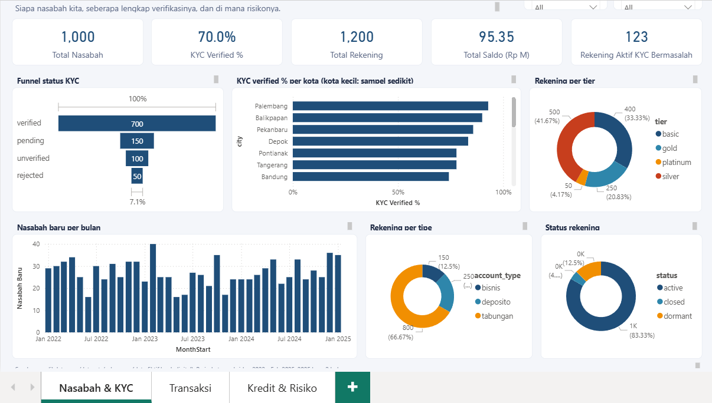
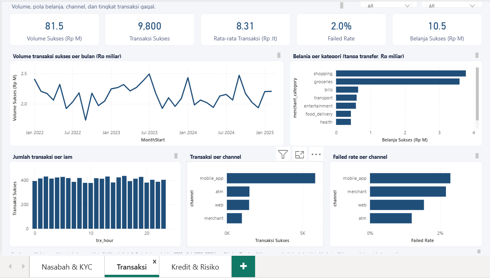
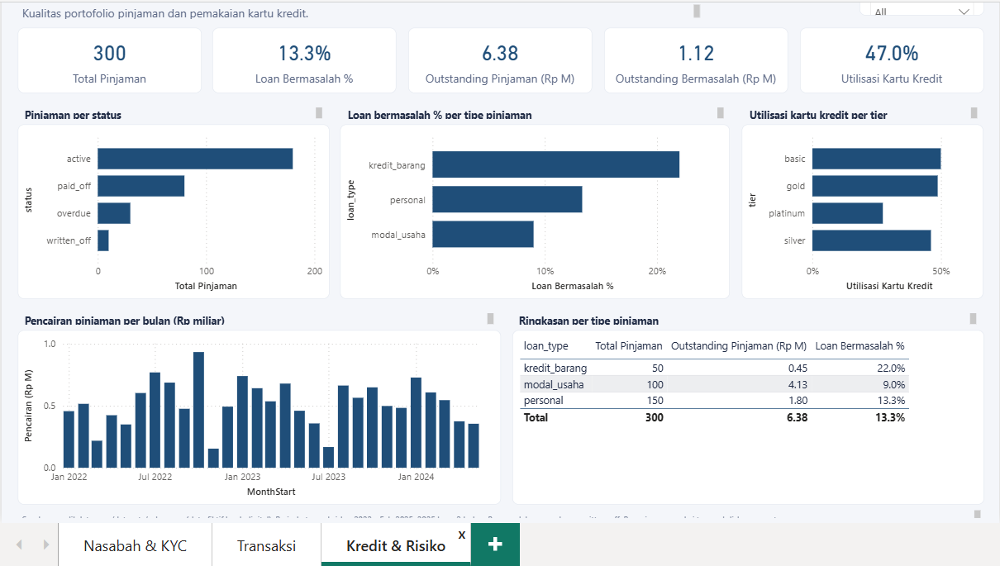

# Sakumaya Digital Bank: Dashboard Power BI

Dashboard 3 halaman untuk menganalisis nasabah, transaksi, dan risiko kredit sebuah bank digital fiktif.
Dibuat dengan Power BI (format project `.pbip`, model dalam TMDL) dari dataset
[Sakumaya](https://ngulikdata.com/datasets/sakumaya).

> Data bersifat sintetis (fiktif). Tidak ada data nasabah sungguhan.

## Pratinjau

| Nasabah & KYC | Transaksi | Kredit & Risiko |
|---|---|---|
|  |  |  |

## Pertanyaan bisnis

1. **Nasabah & KYC:** siapa nasabahnya, seberapa lengkap verifikasinya, dan di mana risiko kepatuhannya?
2. **Transaksi:** bagaimana pola volume, belanja, channel, dan tingkat transaksi gagal?
3. **Kredit & Risiko:** seberapa sehat portofolio pinjaman dan seberapa jauh kartu kredit dipakai?

## Temuan utama

- **Kepatuhan:** 30% nasabah belum berstatus *verified* (150 pending, 100 unverified, 50 rejected).
  Ada **123 rekening aktif** milik nasabah dengan KYC *rejected* atau *unverified*.
- **Kualitas kredit:** **13,3%** pinjaman bermasalah (overdue + written off, 40 dari 300 pinjaman).
  Kredit barang paling tinggi (22,0%), personal 13,3%, modal usaha 9,0%.
- **Konsentrasi risiko:** modal usaha hanya 100 dari 300 pinjaman, tetapi menyumbang
  Rp4,13 M dari total outstanding Rp6,38 M. Outstanding yang bermasalah sekitar Rp1,12 M.
- **Kartu kredit:** utilisasi sekitar **47%** dari total limit.
- **Transaksi:** 9.800 transaksi sukses senilai Rp81,5 M, tingkat gagal **2,0%**. Volume tahunan
  hampir datar (sekitar Rp25-26 M per tahun pada 2022-2024), jadi tidak ada narasi pertumbuhan.
  Belanja didominasi kategori *shopping* dan *groceries*. Channel `mobile_app` menyumbang sekitar 60% transaksi.

## Model data

Star schema sederhana, 5 tabel sumber + tabel kalender + tabel measure:

```
customers ──< accounts ──< transactions >── Kalender
    │            └──< cards
    └──< loans
```

- `customers` → `accounts` → `transactions`/`cards` lewat `customer_id` dan `account_id`.
- `loans` terhubung ke `customers`.
- `Kalender` terhubung ke `transactions[trx_date]` (aktif). Relasi ke
  `customers[registration_date]` dan `loans[disbursement_date]` nonaktif dan dipanggil dengan
  `USERELATIONSHIP` di measure terkait.
- Daftar lengkap measure ada di [`docs/dax_measures.md`](docs/dax_measures.md).

## Cara membuka

1. Clone atau unduh repo ini, lalu unduh dataset gratis dari [Ngulik Data](https://ngulikdata.com/datasets/sakumaya) dan taruh 5 file CSV di folder `data/`.
2. Power BI Desktop: **File > Options and settings > Options > Preview features**, aktifkan
   **Power BI Project (.pbip) save option** dan **Store reports using enhanced metadata format (PBIR)**,
   lalu restart.
3. Buka `SAKUMAYA.pbip`.
4. **Home > Transform data > Edit parameters**, lalu isi `DataFolder` dengan path folder `data/`
   di komputer kamu (tanpa backslash di ujung).
5. Klik **Apply changes** dan **Refresh**.

## Struktur repo

```
SAKUMAYA.pbip
SAKUMAYA.Report/          definisi report (PBIR)
SAKUMAYA.SemanticModel/   model data (TMDL): tabel, relasi, measure
data/                     CSV sumber
docs/dax_measures.md      daftar measure
images/                   screenshot dashboard
```

## Catatan data dan keterbatasan

- Nilai kosong itu wajar dan tidak diisi: `referral_code` (nasabah daftar sendiri),
  `credit_limit_idr` dan `outstanding_idr` (kartu non-kredit), `last_payment_date`
  (10 pinjaman *written off*).
- `balance_after_idr` tidak berurutan terhadap nominal transaksi, jadi tidak dipakai untuk tren saldo.
- Tipe transaksi `credit` bercampur (gaji dan belanja). Karena itu belanja dihitung per
  `merchant_category` (di luar `transfer`), bukan per tipe transaksi.
- Sekitar 73% transaksi bertanggal sebelum rekening dibuat. Ini ciri data sintetis dan dibiarkan apa adanya.
- Data 2025 hanya Januari-Februari. Tren dan perbandingan tahunan sebaiknya memakai 2022-2024.
- Persentase KYC per kota untuk kota kecil memakai sampel sangat sedikit (sekitar 7-14 nasabah),
  jadi chart dibatasi ke kota dengan minimal 50 nasabah.

## Sumber data

Dataset **Sakumaya** dari [ngulikdata.com](https://ngulikdata.com/datasets/sakumaya).
